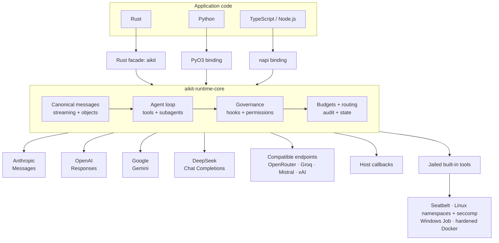
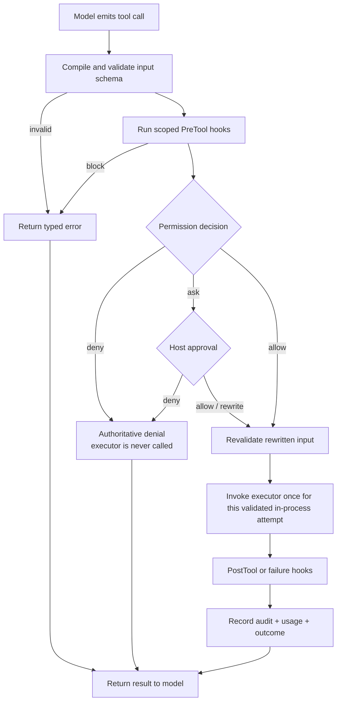

<!-- markdownlint-disable MD013 MD033 MD041 -->

<div align="center">

# aikit-runtime

<p><strong>One governed runtime for serious AI agents.</strong></p>

Build provider-aware agents in **Rust**, **Python**, and **TypeScript** without reimplementing
streaming, tools, policy, routing, budgets, audit, memory, or sessions in every language.

[](https://github.com/matakartal/aikit-runtime/actions/workflows/ci.yml)
[](https://github.com/matakartal/aikit-runtime/actions/workflows/a2a-conformance.yml)
[](https://github.com/matakartal/aikit-runtime/actions/workflows/security.yml)
[](https://scorecard.dev/viewer/?uri=github.com/matakartal/aikit-runtime)
[](https://github.com/matakartal/aikit-runtime/actions/workflows/release.yml)
[](Cargo.toml)
[](crates/aikit-py/pyproject.toml)
[](crates/aikit-node/package.json)
[](#license)

**One core. Three SDKs. Four native providers. Four compatible endpoints. One policy boundary.**

[Quick start](#quick-start) · [CLI](#command-line-interface) · [Next steps](#where-to-go-next) · [Architecture](#architecture) · [Governance](#governed-tool-execution) · [SDKs](#one-runtime-three-sdks) · [Documentation](#documentation)

</div>

---

`aikit-runtime` keeps correctness-sensitive agent behavior in one Rust core and exposes it through
thin native bindings. Anthropic, OpenAI, Google, and DeepSeek retain their native wire formats,
while your application gets one canonical runtime contract.

## Why aikit?

| One runtime | Provider-native | Governed execution |
|---|---|---|
| Rust owns the agent loop; Python and Node call the same implementation. | Provider-specific reasoning, tool calls, citations, usage, and metadata stay intact. | Every side effect passes schema validation, hooks, permissions, budgets, and audit. |
| **Typed developer experience** | **Agent primitives included** | **Production controls built in** |
| Streaming text, structured objects, multimodal messages, typed errors, and cancellation. | Tools, subagents, parallel fan-out, councils, memory, sessions, routing, and retries. | Fail-closed containment, metadata-safe audit, cost limits, scoped tools, and explicit approvals. |

## Architecture



The bindings translate host values and async callbacks at the edge. They do not duplicate policy,
provider translation, or orchestration logic.

## Quick start

`aikit-runtime` is **source-first**: nothing is published to crates.io, PyPI, or npm for this
`v0.3.0-alpha.1` candidate, so every path below starts from a clone. Each quick start uses the
built-in deterministic `mock-1` model, so it needs **no API key and makes no network call**.

| Requirement | Version | Needed for |
|---|---|---|
| Rust | 1.88+ (CI's primary toolchain is 1.97.1) | Everything |
| C/C++ toolchain | Platform default | Python and Node native bindings |
| Python | 3.9+ | Python binding |
| Node.js | 18.17+ | Node binding |

```bash
git clone https://github.com/matakartal/aikit-runtime.git
cd aikit-runtime
```

All commands below run from the repository root. The first build compiles the workspace and takes
a few minutes; later runs are incremental. For a longer, step-by-step walkthrough with the real
output of each command, see [Getting started](docs/GETTING-STARTED.md).

### Rust

```bash
cargo run -p aikit-runtime --example quickstart
```

Expected output. With no tools registered, `mock-1` always returns this canned Turkish reply ("I
received the tool result; I completed the task"); when tools are registered it first calls one, so
the whole tool loop can be exercised offline:

```text
Araç sonucunu aldım; görevi tamamladım.
```

That example is [`crates/aikit/examples/quickstart.rs`](crates/aikit/examples/quickstart.rs):

```rust
use aikit::Agent;

#[tokio::main]
async fn main() -> Result<(), Box<dyn std::error::Error>> {
    let answer = Agent::new()
        .generate_text("Say hello in Turkish", "mock-1", 128)
        .await?;

    println!("{}", answer.text);
    Ok(())
}
```

To use it from your own crate, depend on the checkout by path or by git. The package is
`aikit-runtime`, the library import is `aikit`, and you also need an async runtime such as
`tokio` (features `macros` and `rt-multi-thread`). Pin a `rev` for reproducible builds; CI does not
exercise this external-consumer path, so report any resolution problem as an issue:

```toml
[dependencies]
aikit-runtime = { git = "https://github.com/matakartal/aikit-runtime", rev = "<commit>" }
tokio = { version = "1", features = ["macros", "rt-multi-thread"] }
```

### Python

Build the PyO3 binding into a local virtual environment once:

```bash
python3 -m venv .venv
.venv/bin/pip install --require-hashes -r requirements/maturin.txt
.venv/bin/maturin develop --manifest-path crates/aikit-py/Cargo.toml
```

Save as `hello.py` and run it with `.venv/bin/python hello.py`:

```python
import asyncio
import aikit

async def main() -> None:
    agent = aikit.Agent.from_env({})  # explicit empty env: keyless and deterministic
    answer = await agent.generate_text("Say hello in Turkish")  # model defaults to "mock-1"
    print(answer["text"])

asyncio.run(main())
```

Results are typed dictionaries (see [`aikit.pyi`](crates/aikit-py/aikit.pyi)), so fields are read as
`answer["text"]`. A fuller keyless tour: `.venv/bin/python examples/python/agent_governance.py`.

### TypeScript / Node.js

Build the napi addon (no npm install or network access needed):

```bash
./scripts/build-node.sh
```

Save as `hello.cjs` in the repository root and run it with `node hello.cjs`:

```js
const { Agent } = require("./crates/aikit-node");

async function main() {
  const agent = Agent.fromEnv({}); // explicit empty env: keyless and deterministic
  const answer = await agent.generateText("Say hello in Turkish"); // model defaults to "mock-1"
  console.log(answer.text);
}

main();
```

The `require` path is relative to the repository root; adjust it if your script lives elsewhere.
Types are in [`index.d.ts`](crates/aikit-node/index.d.ts). A fuller keyless tour:
`node examples/node/agent_governance.cjs`.

### Going live with a real provider

The quick starts pass an explicit empty environment so a key in your shell cannot change their
output. To call a real model, provide its key and name a model explicitly:

| Construction | Reads provider keys from |
|---|---|
| Rust `Agent::new()` | Nothing (keyless) |
| Rust `Agent::from_process_env()` | The process environment |
| Python `aikit.Agent()` / Node `new Agent()` | The process environment |
| `Agent::from_env(pairs)` / `aikit.Agent.from_env({...})` / `Agent.fromEnv({...})` | Only the map you pass |

Recognized variables are `ANTHROPIC_API_KEY`, `OPENAI_API_KEY`, `GEMINI_API_KEY` or
`GOOGLE_API_KEY`, `DEEPSEEK_API_KEY`, `OPENROUTER_API_KEY`, `GROQ_API_KEY`, `MISTRAL_API_KEY`, and
`XAI_API_KEY`. The model id selects the provider by prefix: `claude*` (Anthropic), `gpt*` / `o1*` /
`o3*` / `o4*` (OpenAI), `gemini*` (Google), `deepseek*` (DeepSeek), `grok-*` or `xai:` (xAI), and
`openrouter:` / `groq:` / `mistral:` for those endpoints. Choose a model id currently enabled for
your account.

```python
# inside an async function, with e.g. ANTHROPIC_API_KEY exported in your shell
agent = aikit.Agent()
answer = await agent.generate_text("Hello", model="<a claude-... model id>")
```

Run `cargo run -p aikit-cli -- providers` to see which providers your environment activates
(keys are never printed).

## Command-line interface

The source-first CLI makes the runtime usable without writing an application. Its default model
is the deterministic, offline `mock-1` provider:

```bash
cargo run -p aikit-cli -- run "Explain aikit in one sentence"
cargo run -p aikit-cli -- chat
cargo run -p aikit-cli -- providers
cargo run -p aikit-cli -- doctor
cargo run -p aikit-cli -- eval evals/smoke.json
```

Choose a configured provider explicitly only when you intend to make a network call:

```bash
XAI_API_KEY='...' cargo run -p aikit-cli -- run --model grok-4.5 "Say hello"
```

The CLI supports text, JSON, and JSONL output, stable exit codes, stdin prompts, canonical
multi-turn history, secret-safe provider discovery, containment diagnostics, deterministic eval
gates, and shell completion generation. See the [CLI guide](crates/aikit-cli/README.md) for the
full contract.

It can also reuse vendor-owned Codex, Claude, Gemini, and Grok CLI sessions without copying OAuth
tokens into AIKit. Those coding-agent runtimes remain separate from normal API-key providers:

```bash
cargo run -p aikit-cli -- agents discover
cargo run -p aikit-cli -- agents status codex
cargo run -p aikit-cli -- agents run claude "Review this repository"
```

Signed runtime sources can be configured as report-only, vendor-managed, or AIKit-managed. A
managed `agents update sync` streams and verifies the artifact, health-checks it before activation,
and preserves the previous version for rollback. See the
[external-agent and update guide](docs/EXTERNAL-AGENTS.md) for trust setup, Gemini account terms,
and scheduling behavior.

### Troubleshooting first runs

| Symptom | Fix |
|---|---|
| `ModuleNotFoundError: No module named 'aikit'` | Run Python as `.venv/bin/python` (or activate `.venv`), and re-run `maturin develop` after pulling changes. |
| `maturin` cannot find a virtual environment | Create `.venv` in the repository root first, or activate the environment you want to install into. |
| Node cannot load `aikit_node.node` | Re-run `./scripts/build-node.sh` after pulling changes; the addon is a local build output. |
| Unexpected network calls or provider errors | You probably passed a non-`mock` model or constructed the agent from the process environment; use `from_env({})` / `fromEnv({})` with the default model. |
| Anything else | `cargo run -p aikit-cli -- doctor` reports provider discovery and containment diagnostics. |

## Where to go next

| If you want to... | Read |
|---|---|
| Walk through every keyless path step by step | [Getting started](docs/GETTING-STARTED.md) |
| Learn from runnable Python or Node examples | [Python examples](examples/python/README.md) · [Node examples](examples/node/README.md) |
| Register tools and gate them with permissions | [Governed tool execution](#governed-tool-execution), then the [feature reference](docs/FEATURES.md#governance-and-hooks) |
| Use the Python or Node API in depth | [Python binding](crates/aikit-py/README.md) · [Node binding](crates/aikit-node/README.md) |
| Script runs, chats, or evals from a shell | [CLI guide](crates/aikit-cli/README.md) · [Evaluation guide](docs/EVALUATIONS.md) |
| Understand the design and trust boundaries | [Architecture](docs/ARCHITECTURE.md) · [Threat model](docs/THREAT-MODEL.md) |
| Know what is and is not proven yet | [Project status](docs/PROJECT-STATUS.md) · [Parity matrix](docs/PARITY-MATRIX.md) |
| Upgrade from 0.2 | [0.3 migration guide](docs/MIGRATING-0.3.md) |
| Contribute | [CONTRIBUTING.md](CONTRIBUTING.md#local-setup) |

## Built for agent workloads

| Capability | What aikit provides |
|---|---|
| Streaming | Incremental text, reasoning, tool-call, tool-result, usage, and terminal events. |
| Structured output | JSON Schema plus async semantic validation, bounded repair, streaming attempts, Pydantic and Zod materialization. |
| Evaluation | Deterministic text, tool-trajectory, terminal-state, usage, turn, and model-attempt gates over the current invocation. |
| Canonical messages | Text, reasoning, tools, media, citations, usage, and provider-owned metadata without flattening. |
| Governance | Global allow / ask / deny, declarative JSON policy, async approval, lifecycle hooks, and authoritative denial. |
| Plan mode | Whole-approach HITL: the agent proposes a plan; a human approves, revises, or rejects before tools run. |
| Smart approval | Keyless risk scoring auto-allows low-risk `ask` calls and escalates the rest to a human. |
| Reliability rules | Declarative tool ordering, prerequisites, and use caps — separate from security permissions. |
| Off-prompt output | Large or sensitive tool results stored by reference so they do not fill the model context. |
| Guardrails | Deterministic secret/PII redaction, regex blocking, and fail-closed MCP safety-server interop. |
| Self-extension | Human-governed capability requests: the agent asks for a tool it lacks, a human decides, the grant is recorded — never a silent escalation. |
| Tool runtime | Host callbacks plus opt-in Read, Write, Edit, Glob, Grep, and contained Bash. |
| MCP | Bounded stdio and Streamable HTTP client with tools, resources, prompts, auth/session propagation, exact allow/deny visibility filters, and governed execution. |
| Routing | Explicit or automatic model selection from a caller-owned catalog with hard capability and cost gates. |
| Resilience | Typed failures, bounded retry, pre-stream fallback, cancellation, deadlines, and terminal outcomes. |
| Orchestration | Scoped subagents, ordered parallel fan-out, council synthesis, quorum, and shared budget accounting. |
| State | Namespaced memory, revisioned sessions, JSON/transactional SQLite persistence, canonical recording, and resume. |
| Compaction | Opt-in transcript bounding: keep the task anchor and recent tail within a token budget, preserving tool pairing. |
| Durable execution | Append-only run history, fenced worker leases, crash recovery, HITL approvals, reconciliation, SQLite/PostgreSQL stores, and a Sync-mode runtime driver. |
| A2A interoperability | Governed A2A 1.0 mapping in all three SDKs plus an experimental bounded Rust JSON-RPC/SSE listener with artifacts, direct messages, and protected cancellation ingress. |
| Web and browser | HTTPS allowlisted fetch/search plus an existing-session WebDriver executor; browser registration requires an explicit assertion of caller-owned pre-request egress enforcement. |
| Observability | Typed audit lifecycle, metadata-only redaction by default, JSONL sinks, and an optional Rust OpenTelemetry bridge. |

## Governed tool execution

Tool authorization happens immediately before the side effect—not in a prompt and not in a UI
convention.



A denied tool never reaches its callback. Approval and hook rewrites are schema-validated again
before execution. This is not an exactly-once or distributed-execution guarantee: local
coordination is CAS-backed, and an ambiguous provider, tool, or audit effect must be reconciled
before it is retried.

### Example: policy around a host tool

```python
agent = aikit.Agent.from_env({})

async def lookup(payload: dict) -> str:
    return f"price:{payload['symbol']}"

agent.add_tool(
    "lookup",
    "Look up one market symbol",
    {
        "type": "object",
        "properties": {"symbol": {"type": "string"}},
        "required": ["symbol"],
        "additionalProperties": False,
    },
    lookup,
)

agent.set_permissions([
    {"id": "approve-lookups", "effect": "ask", "tool": "lookup"},
])

async def approve(request: dict):
    return "allow" if request["input"]["symbol"] == "AAPL" else "deny"

agent.can_use_tool(approve)
```

The same lifecycle exists in Rust and TypeScript; only the host callback syntax changes.

### Declarative policy, plan mode, and reliability

Rust also ships higher-level governance primitives that compose with the same engine:

```rust
// Declarative JSON → enforcing PermissionEngine
use aikit_core::PolicySpec;
let engine = PolicySpec::from_json(r#"{
  "mode": "allow",
  "deny": ["Bash(rm -rf *)"],
  "ask": ["Bash(git push *)"],
  "allow": ["Read(*)"]
}"#)?.build()?;

// Plan mode: review the whole approach before any tool runs
// cargo run -p aikit-runtime-core --example plan_mode

// Smart approval: auto-allow Low risk, escalate the rest
// cargo run -p aikit-runtime-core --example smart_approval

// Reliability: deploy only after test, at most once
// cargo run -p aikit-runtime-core --example reliability
```

See the [feature reference](docs/FEATURES.md#governance-and-hooks) for plan review, risk scoring,
reliability rules, off-prompt tool output, and capability requests.

## Provider fidelity

`aikit` uses native adapters rather than forcing every provider through one lossy compatibility
shape.

| Provider | Native API | Reasoning continuation | Structured output | Vision |
|---|---|---|---|---:|
| Anthropic | Messages | Signed thinking replayed unchanged | Native JSON Schema constraint | Yes |
| OpenAI | Responses | Opaque reasoning item replayed unchanged | Strict JSON Schema | Yes |
| Google | Gemini `generateContent` | Thought signature retained on the exact function-call part | `responseJsonSchema` | Yes |
| DeepSeek | Chat Completions | Full `reasoning_content` retained for tool continuation | JSON mode + validation and repair | No |

OpenRouter, Groq, Mistral, and xAI are supported through isolated OpenAI-compatible endpoints.
They do not inherit native-provider fidelity claims automatically; capability checks still apply.

### Grok through xAI

Set `XAI_API_KEY`, then select Grok with either its natural model id or the explicit xAI namespace:

```python
agent = aikit.Agent.from_env({"XAI_API_KEY": "..."})
answer = await agent.generate_text("Hello from Grok", model="grok-4.5")
# Equivalent explicit form: model="xai:grok-4.5"
```

The adapter uses xAI's OpenAI-compatible Chat Completions endpoint. Model availability can change;
choose a model currently enabled for your xAI account.

Generated objects report their actual fidelity:

- `native_constrained`
- `forced_tool_call`
- `prompted_and_parsed`

Your application can branch on that grade instead of assuming every JSON-shaped answer has the
same guarantee.

After JSON Schema succeeds, an optional async semantic validator can return `Accept`,
`Retry(reason)`, or `Reject(reason)`. Retry uses the existing bounded repair budget; reject and
callback failures stop with a typed structured-output error. Validators must be pure/idempotent,
and aikit never copies the candidate object into validator errors or audit events automatically.
Retry reasons are provider-facing, so return a safe summary rather than the raw object. Reject and
callback-error details are returned to the host but persist only as generic audit failure markers;
keep those details secret-free too because an application may log exceptions.

## One runtime, three SDKs

| Concept | Rust | Python | TypeScript |
|---|---|---|---|
| Agent | `Agent::new()` | `aikit.Agent()` | `new Agent()` |
| Text | `generate_text` | `generate_text` | `generateText` |
| Streaming | `stream_text` | `stream_text` | `streamText` |
| Structured output | `generate_object` | `generate_object` | `generateObject` |
| Outcome evaluation | `evaluate_outcome` | `evaluate_outcome` | `evaluateOutcome` |
| Tool registration | `tool` / executor | `add_tool` | `addTool` |
| Permissions | `Governance` | `set_permissions` | `setPermissions` |
| Memory | `remember` / `recall` | `remember` / `recall` | `remember` / `recall` |
| Parallel agents | `parallel` | `parallel` | `parallel` |
| Persistent audit | `JsonlAuditSink` | `configure_jsonl_audit` | `configureJsonlAudit` |
| A2A mapper | `A2aMapper` | `aikit.A2aMapper` | `new A2aMapper()` |

Cross-language conformance runs canonical scenarios through all three SDKs and compares normalized
results byte for byte. The registry currently contains eight modules: governance, structured
output, run options, state, orchestration, built-ins, canonical input, and A2A.

## Multimodal and structured input

All text and object surfaces accept a string or canonical message history:

```python
messages = [{
    "role": "user",
    "content": [
        {"type": "text", "text": "Describe this chart"},
        {
            "type": "media",
            "media_type": "image/png",
            "source": {"kind": "url", "url": "https://example.com/chart.png"},
        },
    ],
}]

result = await agent.generate_text(messages, model="your-model")
```

Unsupported media is rejected with a typed error instead of being silently dropped.

## Tools and containment

Built-in tools are explicit and scoped:

```python
agent.register_builtin_tools(["./workspace"])
agent.configure_jsonl_audit("./state/audit.jsonl")
agent.use_memory_file("./state/memory.json", namespace="project-a")
agent.use_session_file("./state/sessions.json")
```

| Surface | Boundary |
|---|---|
| Read / Write / Edit / Glob / Grep | Descriptor-relative jail, registered roots only, no symlink following. |
| Built-in Bash | Required containment: probed macOS Seatbelt, Linux namespaces+seccomp, Windows Job Objects, or hardened digest-pinned Docker. |
| Host callbacks | Your application process and your responsibility to isolate further when needed. |

If required containment is unavailable, built-in Bash is denied before process launch.

## Source module map

`aikit-runtime` is currently distributed from this GitHub repository. Registry packages are a
release gate, not a claim about artifacts that exist today.

| Ecosystem | Workspace package | Import / library |
|---|---|---|
| Rust facade | `aikit-runtime` | `aikit` |
| Rust core | `aikit-runtime-core` | `aikit_core` |
| Python | `aikit-runtime` | `import aikit` |
| Node wrapper | `aikit-runtime` | local checkout wrapper |
| Node native binaries | `aikit-runtime-{platform}` | selected locally by the wrapper |

The current `v0.3.0-alpha.1` tree is a **source-first implementation preview**. Keyless source, binding,
and local package-layout checks run in CI. Use the checkout commands in [Quick start](#quick-start).

### Supported binary targets

These are the targets the manual, non-publishing [artifact workflow](docs/RELEASE.md#manual-artifact-assembly)
builds and load-checks; nothing is uploaded to a registry.

| Platform | Python ABI3 wheel | Node native package |
|---|---:|---:|
| Linux x64, glibc >= 2.28 | Yes | Yes |
| Linux ARM64, glibc >= 2.28 | Yes | Yes |
| macOS ARM64 | Yes | Yes |
| macOS x64 | Yes | Yes |
| Windows x64 | Yes | Yes |

## Verification

```bash
cargo fmt --all --check
cargo clippy --workspace --all-targets --all-features --locked -- -D warnings
cargo test --workspace --all-features --locked --exclude aikit-py
.venv/bin/maturin develop --manifest-path crates/aikit-py/Cargo.toml
./scripts/build-node.sh
./scripts/parity-check.sh
# In another terminal first: cargo run -p aikit-runtime-core --example a2a_tck_sut --locked
AIKIT_A2A_SUT_URL=http://127.0.0.1:9999 ./scripts/a2a-conformance.sh
./scripts/security-check.sh --all
./scripts/release-check.sh --candidate
```

Normal GitHub CI verifies:

- Rust 1.97.1 as the pinned primary toolchain, Rust 1.88 MSRV, rustdoc, and doctests
- Rust / Python / Node canonical parity
- pinned official A2A JSON-RPC MUST reports plus an exact-set false-negative verification gate
- Node native packages on five target combinations
- package dry-runs and native-addon loading
- keyless provider wire contracts and fail-closed containment behavior

The manual source-distribution workflow builds the five Python ABI3 wheels, assembles the native
artifacts, records SHA-256 manifests, and produces GitHub provenance attestations without uploading
anything to a package registry.
Linux wheels and Node addons are built in digest-pinned `manylinux_2_28` containers rather than
inheriting the GitHub runner's newer glibc requirement.

## Repository map

```text
.
├── crates/
│   ├── aikit/          # ergonomic Rust facade (package: aikit-runtime)
│   ├── aikit-core/     # canonical runtime, providers, governance
│   ├── aikit-py/       # PyO3 binding + type stubs (import aikit)
│   ├── aikit-node/     # napi binding + TypeScript declarations
│   └── aikit-cli/      # source-first terminal interface
├── examples/
│   ├── python/         # governance, options, and conformance
│   └── node/           # governance, options, and conformance
├── docs/               # features, threat model, release evidence, roadmap
├── scripts/            # build, parity, packaging, and source checks
├── CONTRIBUTING.md     # setup and design rules
├── SECURITY.md         # private vulnerability reporting
└── CHANGELOG.md        # Keep a Changelog history
```

## Documentation

| Guide | Purpose |
|---|---|
| [Documentation index](docs/README.md) | Full map of guides, policies, and historical notes. |
| [Getting started](docs/GETTING-STARTED.md) | Step-by-step keyless walkthrough from clone to first real provider call. |
| [Architecture](docs/ARCHITECTURE.md) | Ownership boundaries, run lifecycle, state model, and trust boundaries. |
| [Feature reference](docs/FEATURES.md) | Runtime capabilities, governance depth, fidelity, routing, state, and limits. |
| [Threat model](docs/THREAT-MODEL.md) | Security guarantees, containment boundaries, and exclusions. |
| [A2A conformance](docs/A2A-CONFORMANCE.md) | Pinned official TCK procedure, raw result, verified false negatives, and proof boundary. |
| [Project status](docs/PROJECT-STATUS.md) | What is complete, what is intentionally source-only, and the local, CI, live-provider, and publication evidence boundaries. |
| [Distribution guide](docs/RELEASE.md) | Source-first distribution and manual artifact assembly. |
| [Live-provider harness](docs/LIVE-SMOKE.md) | Optional real-provider acceptance test contract. |
| [Competitor parity matrix](docs/PARITY-MATRIX.md) | Current upstream pins, implementation evidence, honest gaps, and the v1 gate. |
| [0.3 migration guide](docs/MIGRATING-0.3.md) | Streaming, MCP naming, capability, durability, and release changes from 0.2. |
| [Historical 0.2 migration guide](docs/MIGRATING-0.2.md) | Archived changes from the 0.1 source preview. |
| [Node binding](crates/aikit-node/README.md) | Local TypeScript / Node checkout usage. |
| [Python binding](crates/aikit-py/README.md) | Local Python checkout usage. |
| [CLI guide](crates/aikit-cli/README.md) | Commands, automation contracts, diagnostics, and completions. |
| [Evaluation guide](docs/EVALUATIONS.md) | Keyless datasets, deterministic gates, reports, and CI exit codes. |
| [External agents](docs/EXTERNAL-AGENTS.md) | Reusing vendor CLI sessions, signed runtime updates, and the credential boundary. |

## Contributing

Contributions are welcome. Start with [CONTRIBUTING.md](CONTRIBUTING.md), follow the
[Code of Conduct](CODE_OF_CONDUCT.md), and report vulnerabilities through the private process in
[SECURITY.md](SECURITY.md).

Questions and usage help belong in [GitHub Discussions](https://github.com/matakartal/aikit-runtime/discussions)
or the channels listed in [SUPPORT.md](SUPPORT.md).

## License

Licensed under either of the following, at your option:

- [Apache License, Version 2.0](LICENSE-APACHE)
- [MIT License](LICENSE-MIT)
