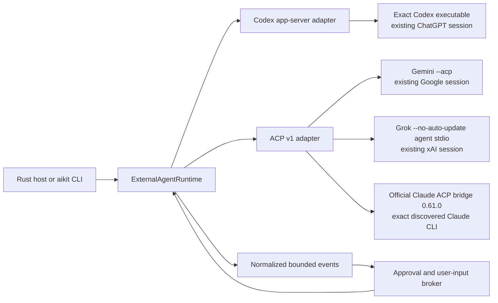

# External coding-agent runtimes

AIKit can reuse a user's existing Codex, Gemini, Claude, or Grok CLI session without requiring an
API key. These runtimes are not model `Provider` adapters: the vendor process owns its account
session, conversation, tool loop, and approval protocol.



## Credential boundary

- AIKit launches an exact, canonical executable without a shell.
- The vendor process reads its own login state. AIKit never reads, copies, refreshes, exchanges, or
  persists OAuth tokens from vendor credential files.
- Codex can report normalized account status through app-server. Stable ACP v1 has no equivalent
  account-read method, so Gemini/Grok status remains `unknown` until the protocol itself provides
  evidence; AIKit does not use a paid prompt as an auth probe.
- Debug representations contain environment variable names, never values. Unknown vendor payloads
  are not forwarded because they can contain prompts, tool arguments, or credentials.
- PAYG API-key variables are masked in child environments. This matters especially for Claude,
  whose API key otherwise takes priority over an authenticated Pro/Max CLI subscription.

## Process and session safety

- RPC frame, pending-request, event, stderr, and outbound-queue sizes are bounded.
- Server-to-client permission requests are correlated to the exact runtime session. Duplicate,
  stale, or cross-session responses fail closed.
- ACP `allow_always` is never treated as a session-only grant. A requested one-shot/session grant
  selects `allow_once`; if that choice is unavailable, the request is cancelled.
- Prompt waiting runs outside the command loop, so cancellation and permission responses do not
  deadlock behind a long turn.
- Ctrl-C sends protocol cancellation; runtime shutdown then terminates the owned process group.
- A generic ACP `session/load` is attempted only with a previously known cwd or an explicit default
  workspace. AIKit never guesses a filesystem scope.

## Discovery and use

```bash
aikit agents discover
aikit agents status codex
aikit agents login codex
aikit agents run gemini "Review this workspace"
aikit agents run grok --approval deny "Explain this diff"
```

An explicit `--path` is an operator decision. If it is invalid, discovery does not silently launch
another PATH candidate. Claude uses the exact official npm bridge pin
`@agentclientprotocol/claude-agent-acp@0.61.0` through `npx` and forces the discovered Claude CLI via
`CLAUDE_CODE_EXECUTABLE`; Node.js 22+ is required. An exact `--bridge PATH` remains available for
air-gapped/preinstalled use, and bridge arguments containing `@latest` are rejected.

## Runtime updates

Runtime discovery, model-catalog refresh, compatibility checks, and binary installation are
separate operations. Importing an AIKit SDK does not start a background updater.

```mermaid
stateDiagram-v2
    [*] --> Idle
    Idle --> Checking: "24h manifest TTL"
    Checking --> Current: "signed manifest; no newer compatible release"
    Checking --> Available: "signed compatible release"
    Checking --> Failed: "network, signature, schema, or compatibility error"
    Failed --> Checking: "retry after 1h, then 6h, then 24h"
    Available --> ReportOnly: "external Homebrew/npm/vendor install"
    Available --> Downloading: "AIKit-managed profile"
    Downloading --> Staged: "size + SHA-256 verified"
    Staged --> Current: "atomic active pointer"
    Current --> RolledBack: "new runtime health check fails"
    RolledBack --> Current: "previous artifact restored"
```



The manifest is verified over its raw bytes with a trusted detached Ed25519 signature before JSON
parsing. It is strict and expiry-bound, declares the external-agent contract/protocol, and selects
one OS/architecture artifact. Artifact URLs must be credential-free HTTPS; size and lowercase
SHA-256 must match.

Managed artifacts are stored side-by-side under their content hash. Activation changes a small
state pointer instead of overwriting a running executable. A runtime descriptor carries the exact
artifact hash used to start it, so existing sessions can pin that hash while new sessions use the
new active pointer. Garbage collection protects active, previous, and host-supplied session pins.

External installations default to `check_only`: AIKit reports that a newer compatible runtime is
available but does not mutate Homebrew, npm, or vendor-managed files. A host may explicitly choose
vendor-managed update behavior. Stable is the default channel; preview must be selected.

## Current proof boundary

Deterministic tests cover discovery without execution, app-server/ACP message handling, event and
permission correlation, signature tampering, target/version selection, retry timing, artifact
hash/size checks, side-by-side activation, persisted update state, and rollback. Local no-prompt
smoke tests have initialized installed Codex, Gemini, and Grok binaries. Claude's exact official
bridge pin is separately checked without a prompt. Those checks are not a billable model acceptance
run, a cross-platform packaging proof, or a signed production release rehearsal. Claude
subscription billing rules are vendor-controlled and must be rechecked when the pinned bridge or
Anthropic policy changes. Recheck the official
[`claude-agent-acp` package pin](https://github.com/agentclientprotocol/claude-agent-acp/blob/main/package.json),
[Claude API-key precedence guidance](https://support.claude.com/en/articles/12304248-manage-api-key-environment-variables-in-claude-code),
and the latest [subscription/ACP status note](https://zed.dev/blog/anthropic-subscription-changes)
together.
