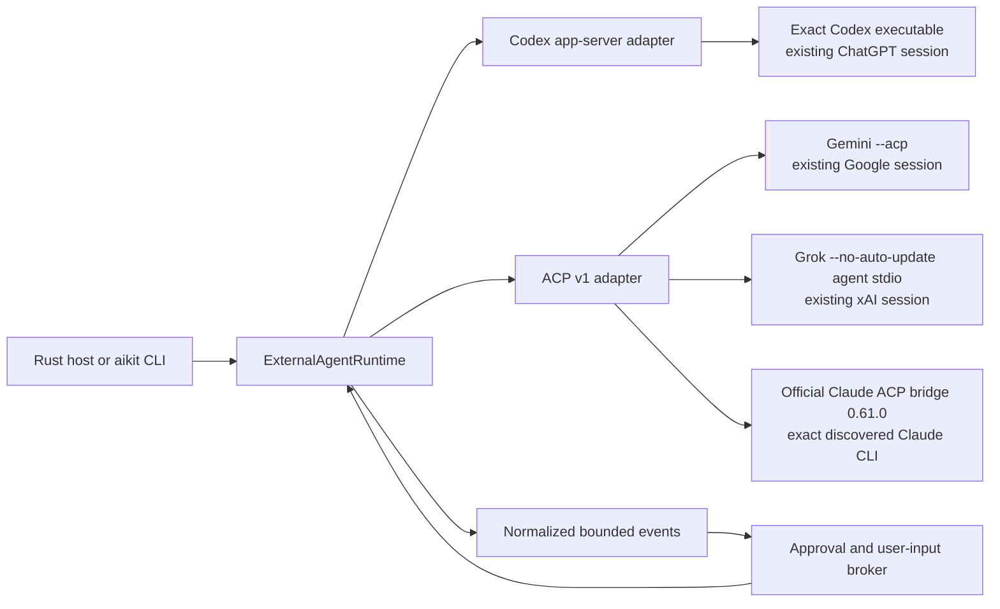

# External coding-agent runtimes

AIKit can reuse a user's existing Codex, Gemini, Claude, or Grok CLI session without requiring an
API key. These runtimes are not model `Provider` adapters: the vendor process owns its account
session, conversation, tool loop, and approval protocol.



## Credential boundary

- AIKit launches an exact, canonical executable without a shell.
- The vendor process reads its own login state. AIKit never reads, copies, refreshes, exchanges, or
  persists OAuth tokens from vendor credential files.
- Codex can report normalized account status through app-server. Stable ACP v1 has no equivalent
  account-read method, so Gemini/Grok status remains `unknown` until the protocol itself provides
  evidence; AIKit does not use a paid prompt as an auth probe.
- Debug representations contain environment variable names, never values. Unknown vendor payloads
  are not forwarded because they can contain prompts, tool arguments, or credentials.
- PAYG API-key variables are masked in child environments. This matters especially for Claude,
  whose API key otherwise takes priority over an authenticated Pro/Max CLI subscription.
- Gemini requires `--acknowledge-vendor-terms` (or
  `AIKIT_ACKNOWLEDGE_GEMINI_CLI_TERMS=true`) before AIKit launches the CLI. Google's official
  [ACP guide](https://github.com/google-gemini/gemini-cli/blob/main/docs/cli/acp-mode.md) describes
  developer-tool integration, while its official
  [terms/privacy guide](https://github.com/google-gemini/gemini-cli/blob/main/docs/resources/tos-privacy.md)
  warns about third-party access to OAuth-backed services. AIKit cannot resolve that account-policy
  ambiguity for the user; the normal Google provider with an API key remains the alternative.

## Process and session safety

- RPC frame, pending-request, event, stderr, and outbound-queue sizes are bounded.
- Server-to-client permission requests are correlated to the exact runtime session. Duplicate,
  stale, or cross-session responses fail closed.
- ACP `allow_always` is never treated as a session-only grant. A requested one-shot/session grant
  selects `allow_once`; if that choice is unavailable, the request is cancelled.
- Prompt waiting runs outside the command loop, so cancellation and permission responses do not
  deadlock behind a long turn.
- Ctrl-C sends protocol cancellation; runtime shutdown then terminates the owned process group.
- A generic ACP `session/load` is attempted only with a previously known cwd or an explicit default
  workspace. AIKit never guesses a filesystem scope.

## Discovery and use

```bash
aikit agents discover
aikit agents status codex
aikit agents login codex
aikit agents run gemini --acknowledge-vendor-terms "Review this workspace"
aikit agents run grok --approval deny "Explain this diff"
```

An explicit `--path` is an operator decision. If it is invalid, discovery does not silently launch
another PATH candidate. Claude uses the exact official npm bridge pin
`@agentclientprotocol/claude-agent-acp@0.61.0` through `npx` and forces the discovered Claude CLI via
`CLAUDE_CODE_EXECUTABLE`; Node.js 22+ is required. An exact `--bridge PATH` remains available for
air-gapped/preinstalled use, and bridge arguments containing `@latest` are rejected.

## Signed runtime updates

Runtime discovery, model-catalog refresh, compatibility checks, and binary installation are
separate operations. Importing an AIKit SDK does not start a background updater.

An operator first pins a manifest location and public signing key. These are placeholder URLs and
key material; this repository does not claim a production update feed:

```bash
aikit agents update configure gemini \
  --manifest-url https://updates.example.com/aikit/gemini/manifest.json \
  --signature-url https://updates.example.com/aikit/gemini/manifest.sig \
  --key-id stable-2026 \
  --public-key-base64 BASE64_RAW_ED25519_PUBLIC_KEY \
  --policy aikit-managed

aikit agents update status gemini
aikit agents update sync gemini --acknowledge-vendor-terms
aikit agents update rollback gemini --acknowledge-vendor-terms
```

`sync` is the automation entrypoint: a host scheduler may run it daily, while the persisted
24-hour TTL avoids unnecessary checks. Failures back off for 1 hour, 6 hours, then 24 hours;
`--force` is an explicit operator override. AIKit does not install a daemon. A cross-process
advisory lock serializes configuration, sync, activation, and rollback for one runtime root.

```mermaid
stateDiagram-v2
    [*] --> Idle
    Idle --> Checking: "sync; 24h manifest TTL"
    Checking --> Current: "signed manifest; no newer compatible release"
    Checking --> Available: "signed compatible release"
    Checking --> Failed: "network, signature, schema, or compatibility error"
    Failed --> Checking: "retry after 1h, then 6h, then 24h"
    Available --> ReportOnly: "external Homebrew/npm/vendor install"
    Available --> Downloading: "AIKit-managed profile"
    Downloading --> Staged: "size + SHA-256 verified"
    Staged --> Failed: "bounded initialize/auth health check fails"
    Staged --> Activating: "health check succeeds"
    Activating --> Current: "atomic active pointer + persisted state"
    Activating --> Current: "next sync recovers interrupted state write"
    Current --> RolledBack: "operator restores previous artifact"
    Failed --> Quarantined: "rejected version is remembered"
    RolledBack --> Quarantined: "rolled-back version is remembered"
    Quarantined --> Available: "strictly newer release appears"
```



The manifest is verified over its raw bytes with a trusted detached Ed25519 signature before JSON
parsing. It is strict and expiry-bound, declares the external-agent contract/protocol, and selects
one OS/architecture artifact. Manifest/signature URLs must be HTTPS without persisted query
credentials. Artifact URLs must be HTTPS without userinfo or fragments; signed-CDN queries are
allowed because the signed manifest authenticates the exact URL. Response and file sizes are
bounded, downloads stream to a temporary file, and lowercase SHA-256 must match before persistence.

Managed artifacts are stored side-by-side under their content hash. Activation changes a small
state pointer instead of overwriting a running executable. A runtime descriptor carries the exact
artifact hash used to start it, so existing sessions can pin that hash while new sessions use the
new active pointer. Normal agent commands prefer the active managed artifact unless the operator
passes an exact `--path`. Garbage collection protects active, previous, and host-supplied session
pins. State/config files are strict, bounded regular files under a hashed instance directory.

External installations default to `check_only`: AIKit reports that a newer compatible runtime is
available but does not mutate Homebrew, npm, or vendor-managed files. A host may explicitly choose
`vendor_managed`, which still reports rather than silently invoking a package manager. Only an
explicit `aikit_managed` policy downloads and activates artifacts. Stable is the default channel;
preview must be selected. Staged binaries must initialize and answer a non-billable auth-status
check before activation. Health failures leave the previous pointer untouched; explicit rollback
atomically restores the previous artifact and quarantines the rejected version.

Default roots are `AIKIT_HOME/runtimes` when configured, the platform user-data directory
otherwise, or an explicit `--root`. `--instance` separates multiple accounts for the same vendor.
Normal agent commands use the corresponding `--runtime-root` and `--instance` values.

## Python and TypeScript projections

The deterministic external-agent surface is projected into both bindings with typed
declarations and strict type-checked tests: `discover_external_runtime_candidates` /
`discoverExternalRuntimeCandidates` (execution-free discovery), `verify_external_update_manifest`
(detached Ed25519 verification before parse), `select_external_runtime_update`,
`validate_external_update_config`, `external_update_refresh_actions`, and the fail-closed
`ExternalUpdateState` state machine with caller-injected instants. The
`EXTERNAL_AGENTS` conformance module in `scripts/parity-check.sh` proves the same
verify/select/transition/backoff transcript byte-identical across Rust, Python, and Node.

Live sessions are projected as well: `spawn_external_agent_session` (Python) /
`spawnExternalAgentSession` (Node) construct a runtime through the shared per-kind spawn policy
in the Rust core — including the Gemini vendor-terms acknowledgement gate and the exact Claude
bridge rules — and return an `ExternalAgentSession` with awaitable
initialize/auth_status/list_models/new_session/prompt/cancel/respond_approval/respond_user_input/
shutdown plus an async event stream over the normalized `RuntimeEvent` feed that fails closed if
the subscriber lags. Keyless CI proof drives a scripted ACP agent through the real official-SDK
client from both languages.

## Current proof boundary

Deterministic tests cover discovery without execution, app-server/ACP message handling, event and
permission correlation, terms gating, signature tampering, strict source configuration,
target/version selection, retry timing, update locking, artifact hash/size checks, side-by-side
activation, persisted state, quarantine, and rollback. Local no-prompt smoke tests previously
initialized installed Codex, Gemini, and Grok binaries. Claude's exact official bridge pin was
separately checked without a prompt. Those checks are not a billable model acceptance run, a
cross-platform managed-update proof, or a signed production-feed rehearsal. Claude subscription
billing rules and all vendor account policies remain vendor-controlled and must be rechecked when
the pinned bridge or policies change. Recheck the official
[`claude-agent-acp` package pin](https://github.com/agentclientprotocol/claude-agent-acp/blob/main/package.json),
[Claude API-key precedence guidance](https://support.claude.com/en/articles/12304248-manage-api-key-environment-variables-in-claude-code),
and the latest [subscription/ACP status note](https://zed.dev/blog/anthropic-subscription-changes)
together.
